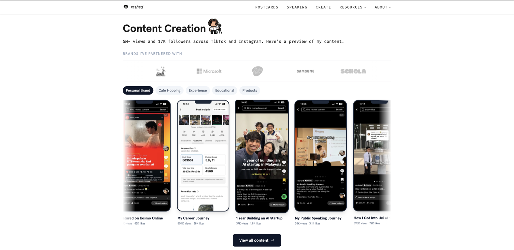
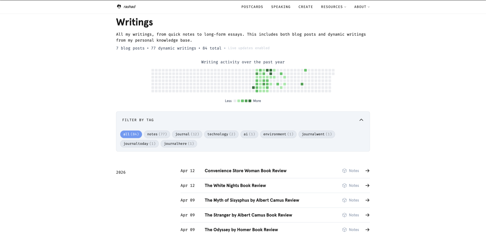
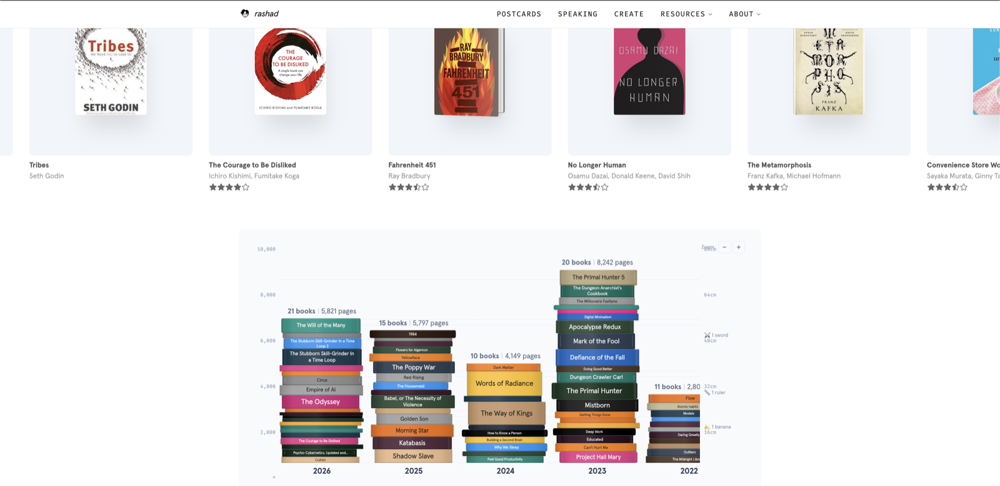
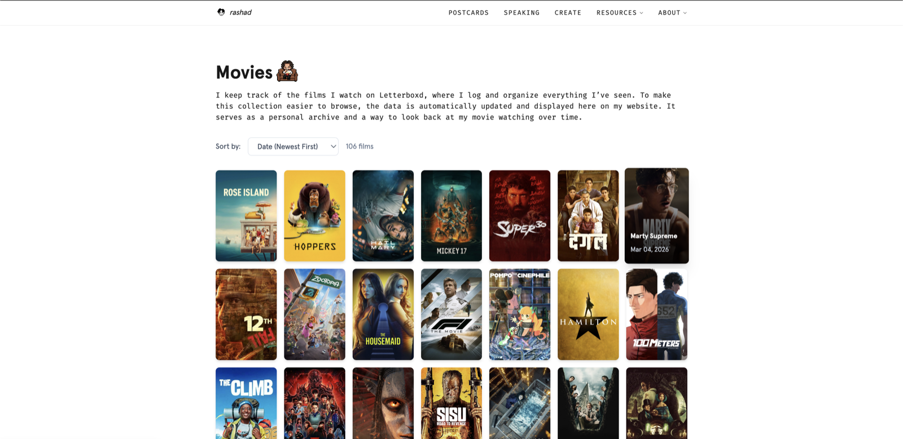
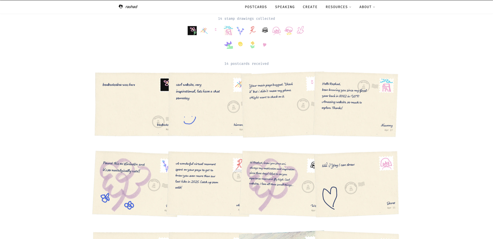
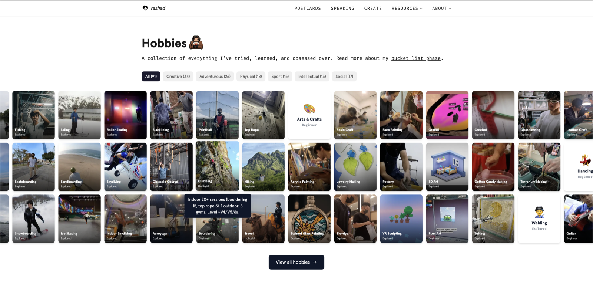
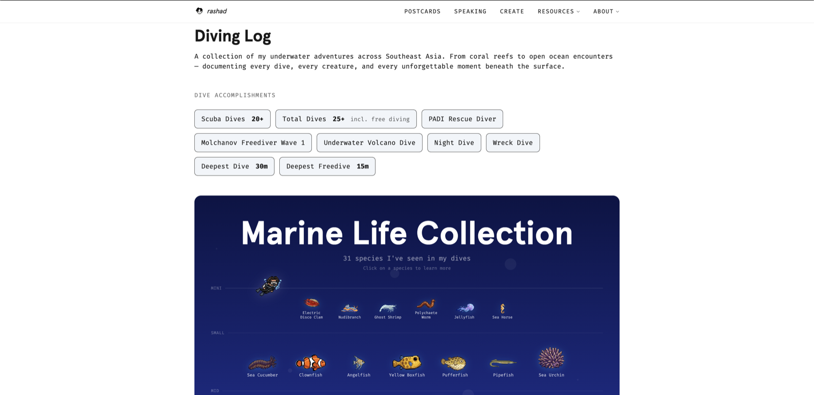
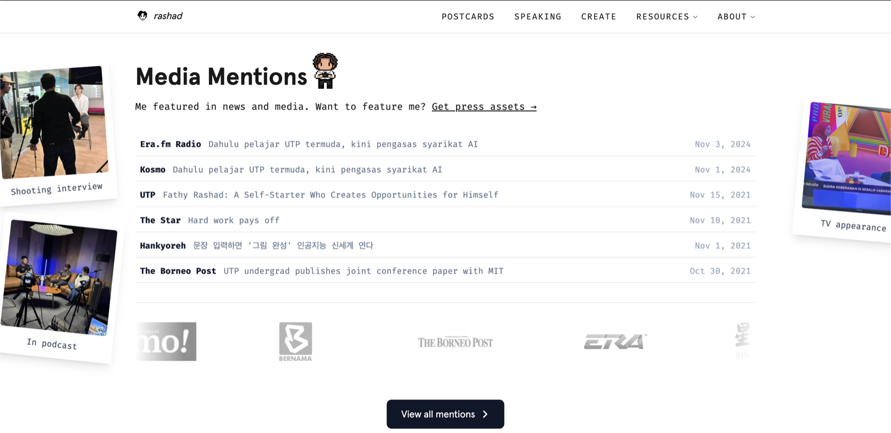

# mfrashad.com

Personal website of Rashad — builder, writer, diver. A living portfolio tracking projects, writing, books, movies, bookmarks, resources, and more. Built with Astro 5 and deployed on Vercel.

**Live site:** [mfrashad.com](https://www.mfrashad.com)

---

## Tech Stack

| Layer | Choice |
|-------|--------|
| Framework | [Astro 5](https://astro.build) — `output: 'server'` with ISR (60 s revalidation) |
| Adapter | `@astrojs/vercel` · Node.js 20 |
| UI components | React 18 islands (`@astrojs/react`) |
| Styling | Tailwind CSS 3.3.5 |
| Content | MDX (blog/notes), local JSON/TS data files, Astro content collections |
| Analytics | [PostHog](https://posthog.com) |
| Guestbook DB | [Turso](https://turso.tech) (libsql / `@libsql/client`) |
| Digital garden | [Cleve](https://cleve.ai) via Convex HTTP client |
| Bookmarks | [Raindrop.io](https://raindrop.io) API |
| Books | [Hardcover](https://hardcover.app) API |
| Movies | Letterboxd scrape (cached at build time) |
| Content studio | [Remotion](https://remotion.dev) 4 — carousel stills + video reels |
| Image pipeline | Playwright (screenshots) · sharp (resize) · node-html-parser (OG/favicons) |
| Fonts | apercu · Fira Mono · LiebeHeide · Fraunces |

---

## Quick Start

```bash
git clone git@github.com:mfrashad/personal-website.git
cd personal-website
npm install
cp .env.example .env   # fill in your keys (all optional — site degrades gracefully)
npm run dev            # http://localhost:4321
```

---

## Pages

| Route | What it is |
|-------|-----------|
| `/` | Home — animated hero, featured projects, latest writing |
| `/about` | Bio, skills tree, timeline |
| `/now` | What I'm working on right now |
| `/blog` | Writing — MDX posts + Cleve notes |
| `/blog/tags/[tag]` | Posts by tag |
| `/topics/[topic]` | Posts by topic (generated from frontmatter) |
| `/books` | Reading list via Hardcover |
| `/movies` | Letterboxd diary (cached at build) |
| `/bookmarks` | Raindrop.io collections |
| `/postcards` | Interactive guestbook (Turso) |
| `/resources` | Curated resource lists (29 categories) |
| `/resources/[category]` | Category detail with card grid |
| `/hobbies` | Hobbies overview |
| `/achievements` | Badges and milestones |
| `/diving` | Dive log |
| `/hackathons` | Hackathon history |
| `/hackathons/[slug]` | Individual hackathon detail |
| `/speaking` | Talks and panels |
| `/create` | Creative projects |
| `/media` | Brand kit / press |
| `/mentions` | Webmentions |
| `/colophon` | How the site is built |
| `/changelog` | Site update history |
| `/garden` → `/blog` | 301 redirect (legacy) |
| `/admin/*` | Local-dev only (disabled in prod) |

---

## Screenshots

<table>
<tr>
<td align="center"><a href="https://www.mfrashad.com/create"></a><br/><sub><b>/create</b> — Content showcase</sub></td>
<td align="center"><a href="https://www.mfrashad.com/blog"></a><br/><sub><b>/blog</b> — Writing & notes</sub></td>
</tr>
<tr>
<td align="center"><a href="https://www.mfrashad.com/books"></a><br/><sub><b>/books</b> — Reading list</sub></td>
<td align="center"><a href="https://www.mfrashad.com/movies"></a><br/><sub><b>/movies</b> — Letterboxd diary</sub></td>
</tr>
<tr>
<td align="center"><a href="https://www.mfrashad.com/postcards"></a><br/><sub><b>/postcards</b> — Guestbook</sub></td>
<td align="center"><a href="https://www.mfrashad.com/hobbies"></a><br/><sub><b>/hobbies</b> — Hobbies overview</sub></td>
</tr>
<tr>
<td align="center"><a href="https://www.mfrashad.com/diving"></a><br/><sub><b>/diving</b> — Dive log</sub></td>
<td align="center"><a href="https://www.mfrashad.com/media"></a><br/><sub><b>/media</b> — Press & mentions</sub></td>
</tr>
</table>

---

## Data Sources

| Feature | Page | Source |
|---------|------|--------|
| Blog posts | `/blog` | MDX content collection (`src/content/blog/`) |
| Notes / garden | `/blog` | Cleve (Convex HTTP) — `src/api/cleve.ts` |
| Books | `/books` | Hardcover API — `src/api/hardcover.ts` |
| Movies | `/movies` | Letterboxd scrape cached at `src/data/letterboxd-cache.json` |
| Bookmarks | `/bookmarks` | Raindrop.io API — `src/api/raindrop.ts` |
| Guestbook | `/postcards` | Turso (libsql) — `src/lib/postcards-db.ts` |
| Resources | `/resources/[category]` | 29 TS data files in `src/data/lists/` |
| Resource images | Resources cards | Manifest at `src/data/resource-images.json` (fetched by script) |
| Projects, skills, etc. | `/about`, `/achievements` | Local data files (`src/data/`) |

---

## Environment Variables

All variables are optional — the site degrades gracefully when a key is absent.

### Public (exposed to the browser)

| Variable | Used for |
|----------|---------|
| `PUBLIC_SITE_URL` | Canonical URL / OG tags |
| `PUBLIC_POSTHOG_KEY` | PostHog analytics |
| `PUBLIC_FORMSPREE_URL` | Contact form endpoint |
| `PUBLIC_CONVEX_URL` | Cleve/Convex garden writings |
| `PUBLIC_WEBMENTION_IO_DOMAIN` | Webmention badge |

### Server-only

| Variable | Used for |
|----------|---------|
| `CLEVE_PROFILE_SLUG` | Your Cleve username for `fetchCleveWritings()` |
| `TURSO_DATABASE_URL` | Guestbook/postcards DB |
| `TURSO_AUTH_TOKEN` | Guestbook/postcards DB auth |
| `HARDCOVER_API_KEY` | Books API |
| `RAINDROP_TOKEN` | Bookmarks API |
| `TMDB_API_KEY` | Movie poster images (build-time script) |
| `PEXELS_API_KEY` | Placeholder images (build-time script) |
| `WEBMENTION_IO_TOKEN` | Webmentions build-time fetch |
| `RESEND_API_KEY` | Server-side email (optional) |
| `GREENSCREEN_URL` | Local Python greenscreen server URL (admin only, default `http://localhost:8000`) |

Copy `.env.example` → `.env` for the full annotated list.

---


## npm Scripts

| Script | What it does |
|--------|-------------|
| `npm run dev` | Start dev server on :4321 |
| `npm run build` | Astro build → post-process Vercel functions |
| `npm run preview` | Preview the production build locally |
| `npm run fetch:movies` | Scrape Letterboxd → `src/data/letterboxd-cache.json` |
| `npm run fetch:cleve` | Fetch Cleve writings → `src/data/cleve-cache.json` |
| `npm run fetch:resource-images` | Fetch OG images + favicons for resource cards |
| `npm run fetch:resource-screenshots` | Playwright screenshots of resource URLs |
| `npm run fetch:book-covers` | Fetch Hardcover book cover images |
| `npm run fetch:game-anime-images` | Fetch TMDB/IGDB images for games + anime |
| `npm run build:links` | Generate link graph from content |
| `npm run build:topics` | Generate topic index from frontmatter |
| `npm run build:webmentions` | Fetch webmentions from webmention.io |
| `npm run remotion:studio` | Open Remotion Studio for composition preview |
| `npm run chrome:debug` | Launch Chrome with remote debugging (for Playwright dev) |
| `npm run process:speaking-images` | Optimise speaking-event photos |
| `npm run process:content-images` | Optimise content-generator output images |

---

## Deployment

The site is deployed on **Vercel**. Push to `main` → automatic deploy.

Required env vars to add in the Vercel dashboard (Settings → Environment Variables):

```
PUBLIC_CONVEX_URL        # Cleve garden
CLEVE_PROFILE_SLUG
PUBLIC_POSTHOG_KEY
PUBLIC_FORMSPREE_URL
TURSO_DATABASE_URL       # Guestbook
TURSO_AUTH_TOKEN
HARDCOVER_API_KEY
RAINDROP_TOKEN
TMDB_API_KEY
WEBMENTION_IO_TOKEN
PUBLIC_WEBMENTION_IO_DOMAIN
```

The site builds and runs without any of these set — missing integrations are silently skipped.

---

## License

**Code** — MIT. See [LICENSE](LICENSE).

**Personal content** — all blog posts, photos, project descriptions, and brand assets remain © Rashad. All Rights Reserved. See the Personal Content section of [LICENSE](LICENSE) for details.

**Fonts** — bundled fonts are licensed separately. See the Fonts section of [LICENSE](LICENSE).
